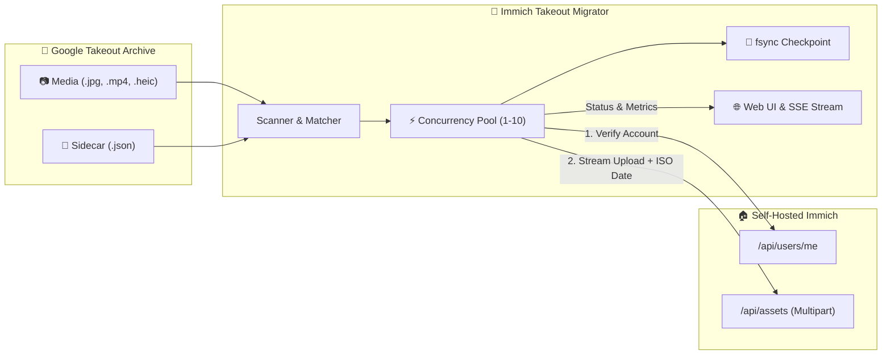

<div align="center">

  

  # Immich Google Takeout Migrator

  **Effortless, resilient, and ultra-fast web-based migration tool for importing massive Google Takeout archives (120 GB+) into your self-hosted Immich instance.**

  [](LICENSE)
  [](docker-compose.yml)
  [](package.json)
  [](tests/)
  [](https://github.com)
  [](public/index.html)

  <br />

  [Features](#-key-features) •
  [Architecture](#-architecture) •
  [Quick Start](#-quick-start) •
  [Web Interface](#-web-interface) •
  [Takeout Parsing](#-how-takeout-sidecars-are-handled) •
  [Testing](#-testing) •
  [Türkçe Açıklama](#-t%C3%BCrk%C3%A7e)

</div>

---

## 💡 Why This Tool?

Migrating 100+ GB of Google Photos exports is notoriously frustrating:
* **Separated Metadata:** Capture dates, GPS coordinates, descriptions, and favorite flags are exiled into companion `.json` sidecar files instead of the media files.
* **Corrupted & Truncated Filenames:** Google Takeout arbitrarily truncates long filenames at 46–51 characters, creates weird duplicate formats (`photo(1).jpg` $\leftrightarrow$ `photo.jpg(1).json`), and drops extensions.
* **Interrupted Uploads:** If your terminal, computer, or Wi-Fi crashes 4 hours into a 120 GB transfer, standard scripts start over from scratch or waste gigabytes uploading duplicates.
* **Command-Line Fatigue:** Not everyone wants to mess around with Python virtual environments, missing libraries, or complex CLI parameters.

**Immich Takeout Migrator** solves this once and for all: it provides a **single-command Docker deployment**, an **interactive web dashboard**, multi-threaded speed, an **interactive folder browser**, and **crash-proof `fsync` persistence**.

---

## 🌟 Key Features

| Feature | Description |
| :--- | :--- |
| 🌐 **Modern Web Dashboard** | Complete control via your browser (`http://localhost:3000`). No CLI commands needed after launch. |
| 📁 **Interactive Folder Browser** | Type paths directly or click the **Browse** button to visually explore and pick directories. |
| ⚡ **Multi-Threaded Concurrency** | Configurable worker pool (1–10 streams) saturates your local network and storage bandwidth. |
| 📊 **Real-time Live Metrics** | Combined speed (`MB/s`), accurate remaining time (`ETA`), percentage bar, and active worker indicators. |
| 🧠 **Smart Sidecar Matcher** | Resolves exact `.ext.json`, extensionless `.json`, Google duplicate parenthesized patterns, and truncated names. |
| 💾 **Crash-Proof `fsync` Checkpoint** | Flushes state directly to physical disk. If your computer shuts down, it safely resumes in seconds. |
| 🛡️ **Zero Duplicate Waste** | Auto-detects server-side duplicates (`409 Conflict` or status duplicate) and marks them as skipped. |
| 🌍 **Bilingual Interface** | Instant toggle between **English** and **Türkçe** (saved in local storage). |
| 📜 **Live Terminal Console** | Watch real-time log events via Server-Sent Events (SSE) with one-click log export. |

---

## 🏗️ Architecture



---

## 🚀 Quick Start

### Option A: Docker Compose (Recommended)

1. **Clone the repository:**
   ```bash
   git clone https://github.com/your-username/immich-transfer.git
   cd immich-transfer
   ```

2. **Configure your volume mount in `docker-compose.yml`:**
   ```yaml
   services:
     immich-transfer:
       build: .
       container_name: immich-transfer
       ports:
         - "3000:3000"
       volumes:
         # Path to your extracted Google Photos Takeout folder (Read-Only):
         - /path/to/Google Photos:/takeout:ro
         # Local directory for checkpoints and logs:
         - ./data:/data
       restart: unless-stopped
   ```

3. **Start the service:**
   ```bash
   docker compose up -d
   ```

4. Open **[`http://localhost:3000`](http://localhost:3000)** in your browser!

---

### Option B: Bare Metal (Node.js 20+)

If you prefer running without Docker:

```bash
# 1. Install dependencies
npm install

# 2. Run automated verification tests
npm test

# 3. Start the server
npm start
```

Visit `http://localhost:3000` to access the dashboard.

---

### Option C: Standalone Python CLI

For headless servers or environments where you only have Python:

```bash
python3 -m venv .venv
source .venv/bin/activate
pip install -r requirements.txt
cp .env.example .env     # Fill in your Immich URL and API Key
python3 transfer.py
```

---

## 🖥️ Web Interface Walkthrough

1. **Account Verification:** Enter your Immich Server URL and API Key, then click **"Verify Connection & Account"**. It queries `/api/users/me` and displays a confirmed green badge with the target user's avatar, name, and email.
2. **Directory Selection:** Either type the path or click the yellow **"Browse"** button to open the interactive directory explorer modal.
3. **One-Click Scan:** Click **"Scan Takeout Folder"**. The app calculates total media files, already migrated assets, new files, and total volume in gigabytes.
4. **Start & Monitor:** Hit **"Start Migration"**. Watch real-time upload speed (`MB/s`), remaining time (`ETA`), percentage bars, and live worker threads as they stream data.
5. **Pause & Resume Anytime:** Safely pause, stop, or reboot your system. The tool never re-uploads files already confirmed by the checkpoint.

---

## 🧩 How Takeout Sidecars Are Handled

Google Takeout companion `.json` files are matched using a multi-tier fallback strategy:

1. **Direct Match:** `filename.ext.json` (e.g. `IMG_001.JPG.json`)
2. **Extensionless Match:** `filename.json` (e.g. `IMG_001.json`)
3. **Duplicate Parenthesis Pattern:** `IMG_001(1).JPG` $\rightarrow$ `IMG_001.JPG(1).json` or `IMG_001(1).JPG.json`
4. **Truncated Names:** Long filenames exceeding ~46 characters are fuzzy-matched against truncated JSON files sharing the identical stem prefix.
5. **Fallback:** If a JSON sidecar is absent or malformed, the file's filesystem modification time (`mtime`) is used as a reliable fallback without halting execution.

---

## 🧪 Testing

The repository comes with a zero-external-dependency automated test suite testing the scanner, sidecar parser, `fsync` persistence, and an in-process mock Immich HTTP server.

```bash
npm test
```

**Test Coverage Summary:**
* `TakeoutScanner`: File filtering and edge-case sidecar metadata extraction.
* `CheckpointManager`: Disk persistence, restart recovery, and error isolation.
* `ImmichClient`: User authentication verification and multipart asset streaming.
* `End-to-End Migrator`: Full pipeline execution from scan to 100% completion.
* `Folder Browser`: Subdirectory navigation and parent traversal.

---

## ⚙️ Configuration Reference

| Environment Variable | Default | Description |
| :--- | :--- | :--- |
| `PORT` | `3000` | Port for the web dashboard. |
| `DATA_DIR` | `/data` or `./data` | Directory where `checkpoint.jsonl` and `transfer.log` reside. |
| `TAKEOUT_DIR` | `/takeout` | Default directory path shown in the web browser. |
| `IMMICH_INSTANCE_URL` | *None* | Optional pre-fill for the Immich server URL. |
| `IMMICH_API_KEY` | *None* | Optional pre-fill for the Immich API Key. |
| `CONCURRENCY` | `4` | Default number of parallel upload workers (1–10). |

---

## 🇹🇷 Türkçe

Google Takeout ile indirilen devasa fotoğraf ve video arşivlerini (120 GB+) self-hosted **Immich** sunucunuza kolayca, güvenle ve maksimum hızla aktaran modern, Docker destekli web aracıdır.

- **Tek Tıkla Docker Kurulumu:** `docker compose up -d` komutuyla anında ayağa kalkar.
- **İnteraktif Klasör Gezgini (Gözat):** Klasör yolunu ister elle yazın, ister "Gözat" penceresiyle tıklayarak seçin.
- **Paralel Yükleme:** Ağ hızınızı tam kapasite kullanan çoklu iş parçacığı (1–10 thread).
- **Kapanma Koruması (`fsync`):** Bilgisayar kapansa bile kaldığı dosyadan anında devam eder.
- **Türkçe & İngilizce Desteği:** Sağ üst köşedeki butonla anında dil değiştirilebilir.

Detaylı Türkçe kullanım adımları için [Hızlı Başlangıç](#-quick-start) bölümünü inceleyebilirsiniz.

---

## 📄 License

Distributed under the **MIT License**. See `LICENSE` for more information. Free for personal and commercial self-hosted use.
